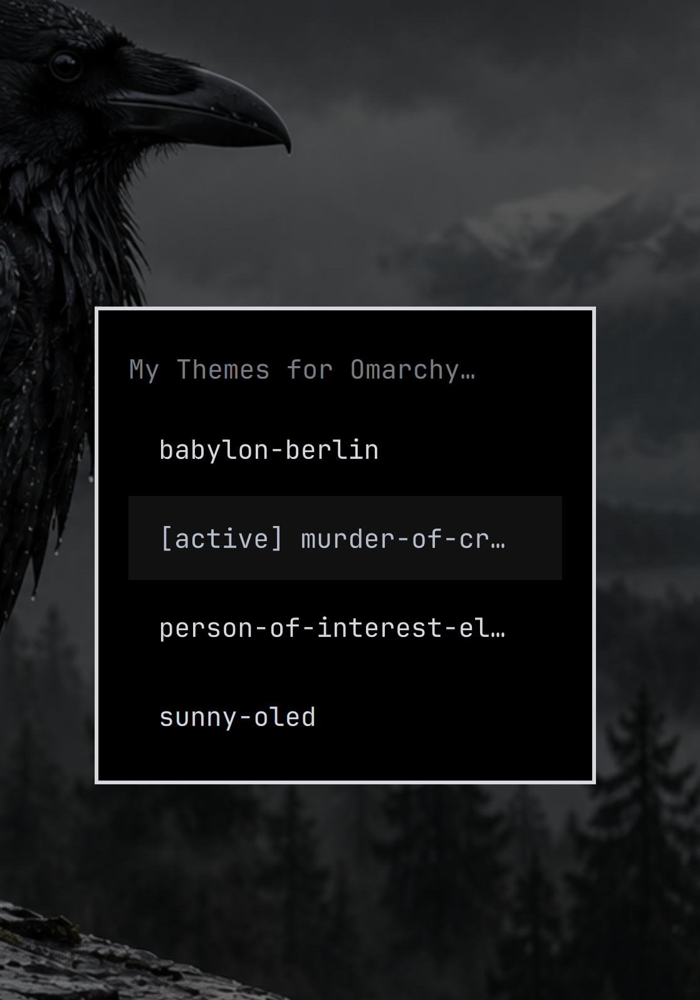

# My Themes for Omarchy

A lightweight, searchable picker for your custom Omarchy themes. Python standard library only. Built-in themes and the original picker remain untouched.

**[Download v0.2 ZIP](https://github.com/RobbieUK1/My-Themes-for-Omarchy/releases/download/v0.2/My-Themes-for-Omarchy-v0.2.zip)** · **[Release notes](https://github.com/RobbieUK1/My-Themes-for-Omarchy/releases/tag/v0.2)**



Screenshot supplied by RobbieUK1.

## Optional top bar button

The normal installation below adds an application launcher entry and **no bar button**. You can use My Themes entirely from the application launcher.

If you already enabled the plugin button, choose **Hide top bar button** inside the picker and confirm. You can also run:

```bash
omarchy plugin disable io.github.robbieuk1.my-themes
```

Disabling the widget leaves the standalone application and your saved choices available. Install/update the standalone app below to get its launcher entry; plugin-only users can also run `python3 ~/.config/omarchy/plugins/io.github.robbieuk1.my-themes/my-themes` while the plugin is disabled.

To opt into the bar button on Omarchy Quattro:

```bash
omarchy plugin add https://github.com/RobbieUK1/My-Themes-for-Omarchy --enable
```

Left-click opens the picker; right-click opens wallpaper previews. For an existing plugin installation, update with `omarchy plugin update io.github.robbieuk1.my-themes`. Re-enable a hidden button with `omarchy plugin enable io.github.robbieuk1.my-themes`.

To remove the optional plugin checkout, use `omarchy plugin remove io.github.robbieuk1.my-themes`. This does not remove the standalone app or any themes.

License: MIT. Marketplace submission is awaiting maintainer review. Requires Python 3 and Omarchy's native menus; older systems can use the graphical picker fallbacks and terminal checklist described below.

## Install or update (v0.2)

Run this one-line command as your normal user (no sudo). Requires Bash, curl, unzip and Python 3:

```bash
bash -c 'set -euo pipefail; d=$(mktemp -d); trap '\''rm -rf "$d"'\'' EXIT; curl -fL https://github.com/RobbieUK1/My-Themes-for-Omarchy/releases/download/v0.2/My-Themes-for-Omarchy-v0.2.zip -o "$d/themes.zip"; unzip -q "$d/themes.zip" -d "$d"; bash "$d/my-themes-omarchy/install.sh"'
```

Or extract the ZIP and run `bash install.sh` inside `my-themes-omarchy`.

Launch **My Themes for Omarchy** from your application launcher or run `~/.local/bin/my-themes`. If `~/.local/bin` is on PATH, use `my-themes`.

## Search and previews

The default menu uses Omarchy's native searchable menu on current releases, then falls back to Fuzzel, Rofi, Wofi, or a numbered terminal menu on older systems. The active theme is marked `[active]`.

```text
My Themes for Omarchy
  babylon-berlin
  [active] murder-of-crows
  person-of-interest-electronic-blue
  sunny-oled
```

This is an illustrative text preview, not a desktop screenshot.

Run `my-themes --previews` for Omarchy's native searchable wallpaper thumbnail picker. It uses each theme's preview.png/preview.jpg or its first supported wallpaper, including user background overrides. If any theme lacks an image, it returns to the complete list so no theme becomes inaccessible. Requires `omarchy-menu-images` and its normal Omarchy dependencies; no additional Python packages. Escape cancels.

## Choose pre-installed themes

Open My Themes and select **Add pre-installed themes…**. Check the bundled themes you want to see, then choose **Apply**. Existing choices are checked when you reopen the checklist. Uncheck a theme to hide it again; clearing every checkbox returns to custom-only mode. Escape cancels without saving or switching the active theme.

You can open the checklist directly with `my-themes --manage-stock`, or the **Choose pre-installed themes** launcher action where supported. The graphical checklist uses Omarchy's native multi-selection menu. On older installations, run that command in a terminal for a numbered selection; the normal theme picker still supports Fuzzel, Rofi and Wofi.

Your choices are saved in `~/.config/my-themes-omarchy/include.txt`. This changes only what My Themes displays. Bundled themes remain installed and available in Omarchy's original picker. The checklist does not switch themes.

## Theme discovery

Automatically scans `~/.config/omarchy/themes/`, including symlinked custom themes, plus bundled theme directories for themes you explicitly selected. Same-name overlays appear once. Recognizes colors.toml, alacritty.toml, preview.png, backgrounds or .git in custom theme folders. Does not move, delete, update or rewrite themes. Switching delegates to `omarchy theme set <slug>` (legacy `omarchy-theme-set` fallback).

Use `my-themes --list` to inspect displayed slugs. Manual entries in include.txt remain supported. `exclude.txt` always hides matching entries, including from the checklist; remove a theme from that file if you want to choose it again. Blank lines and comments beginning with # are ignored.

## Compatibility and verification

Reviewed against Omarchy 4.5.0-3 installed command sources and current upstream theme-set/theme-list scripts on 7 November 2026. The old picker did not support the native menu and compared display names against slugs; both are corrected. Automated isolated checks cover filtering, active labels, validated switching, cancellation, preview mapping and installation/uninstallation. No live theme switch is performed during verification. Graphical appearance depends on your Omarchy theme and menu backend; the v0.1 picker has been confirmed working by its user. The new checklist and bar opt-out have isolated automated coverage; their live graphical behavior has not been visually verified.

Installer writes only `~/.local/bin/my-themes`, its own configuration directory and its own application launcher entry. It does not alter bindings, Omarchy menus, packaged files or update behavior. Re-running it updates this utility.

## Uninstall

Run `bash uninstall.sh` from an extracted download. Keeps all themes and personal utility settings. No keyboard bindings are installed automatically.
